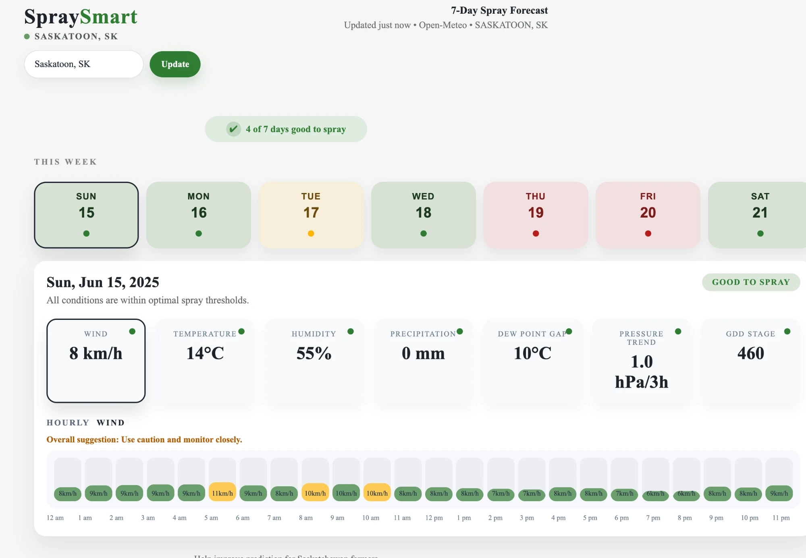
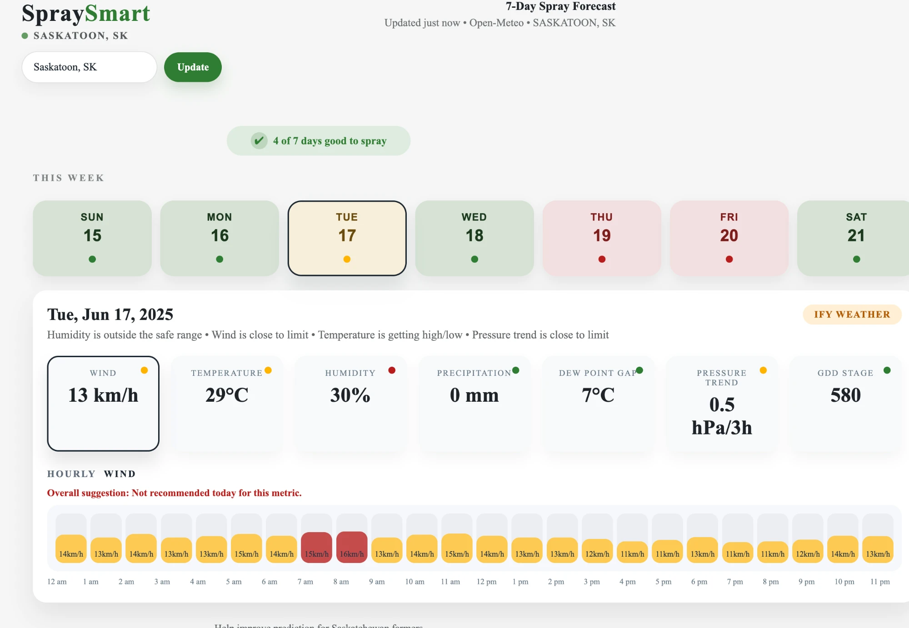
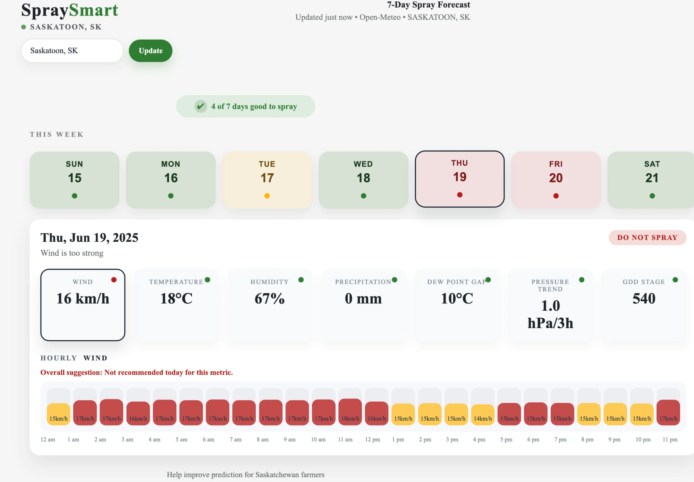

# SprayMart

**2nd place, 2026 University of Saskatchewan Agriculture Technology Hackathon**

SprayMart tells farmers when the weather is right to spray herbicide. It turns raw weather numbers (wind, temperature, humidity, rain and more) into a simple 7 day view where each day is marked green (good to spray), yellow (borderline) or red (do not spray), with a plain language reason for each call.

---

## The problem

Herbicide only works well when the weather cooperates. Spray on the wrong day and the farmer loses money, time and crop:

- **Too windy** and the spray drifts off the field onto neighbouring crops, yards or water.
- **Rain soon after spraying** washes the product off the leaves before it can work.
- **Too hot or too dry** and the droplets evaporate before they reach the weed.
- **Too cold** and the weeds are not growing actively, so they take up less herbicide.
- **The wrong crop stage** means the weeds are too big to kill, or the crop itself can be damaged.

Farmers already check the weather, but they have to weigh six or seven different numbers in their head, hour by hour, across a whole week. Spray windows can be just a few hours long, and missing one can mean waiting days for the next.

## How the idea came about

Before writing any code, we interviewed agriculture professors at the University of Saskatchewan about what actually decides whether a herbicide application succeeds. What we learned shaped three design choices:

1. Success depends on several weather factors at once, not just one, so the app checks all of them together.
2. Farmers need an answer they can read at a glance, not a page of numbers, so every day gets one colour and a short reason.
3. Rules of thumb are a good starting point, but the real test is whether the spray actually worked in the field. That led to the long term plan: learn from farmers' own results (see [Where it is headed](#where-it-is-headed-learning-from-every-spray)).

## What the app does

The dashboard shows a week of spray conditions for a chosen location (Saskatoon by default; you can search for any town).

- **Week strip:** seven day cards, each with a green, yellow or red dot. A summary pill at the top says how many days are good to spray.
- **Day detail:** click a day to see the averages for that day's spray window, a status badge, and the reasons behind it (for example "Wind is close to limit").
- **Hourly chart:** click any measurement card to see it hour by hour from 5 am to 2 pm, with each bar coloured by whether that hour is good, borderline or bad. The app focuses on 5 am to 2 pm because morning is the most practical spraying period.

### Reading the colours

Everything in SprayMart uses the same three colours, so a farmer can read the week at a glance:

- **Green: spray.** The weather is inside the safe range.
- **Yellow: caution.** Conditions are getting close to a limit. Spraying may still work, but watch the weather closely.
- **Red: do not spray.** At least one condition is outside the safe range.

The colours appear at three levels: on each day card in the week strip, on each of the seven measurement cards (the small dot in the corner), and on each hour's bar in the hourly chart.

*The screenshots below show the dashboard's built in sample week, which it displays when the backend is not running.*

**A green day.** Sunday has light wind (8 km/h), a mild temperature, moderate humidity and no rain. All seven measurement dots are green, the badge says "Good to spray", and almost every hour in the wind chart is green.



**A yellow day.** Tuesday is hot (29 °C) and dry (30 % humidity), with wind close to the limit (13 km/h). The reasons line lists each concern, and the hourly wind chart is mostly yellow, with red at 7 am and 8 am when the wind reaches 15 to 16 km/h.



**A red day.** Thursday is too windy (16 km/h). Every other measurement is fine, but wind drift alone makes it unsafe, so the badge says "Do not spray" and most hours in the wind chart are red.



### The seven checks

Each day is scored on seven measurements, averaged over its 5 am to 2 pm window. Each one is rated good, borderline ("iffy") or bad using these thresholds (from `api/server.py`):

| Measurement | Good | Bad | What it means |
|---|---|---|---|
| Wind | 10 km/h or less | over 15 km/h | Strong wind causes drift |
| Temperature | 12 to 25 °C | under 10 or over 30 °C | Cold slows weeds down; heat evaporates spray |
| Humidity | 50 to 80 % | under 40 or over 90 % | Dry air evaporates droplets; very wet air slows drying |
| Precipitation | 0 mm | over 2 mm | Rain washes herbicide off the leaf |
| Dew point gap | 5 to 15 °C | under 3 or over 20 °C | The gap between air temperature and dew point. A small gap means dew or fog; a large gap means very dry air |
| Pressure trend | rising 1 to 3 hPa over 3 hours | falling more than 1 or rising more than 3 hPa | A sharp change in air pressure signals a weather front moving in |
| GDD stage | 350 to 600 | under 200 or over 800 | Growing degree days, a running total of heat that tracks how far the crop has developed |

Anything between "good" and "bad" counts as borderline. The day's overall colour goes to whichever rating most of the seven checks received.

In the current version the GDD value is not yet calculated from the weather: it comes from a growth stage setting (stage 3 by default, which gives 500).

## Where it is headed: learning from every spray

The thresholds above are a rules based starting point. The bigger goal is a model that learns from real outcomes:

1. **Record every spray.** When a farmer sprays, the app saves the weather conditions at that time (temperature, humidity, wind, rain, pressure, dew point gap, crop stage).
2. **Ask one question afterwards.** A few days later the app asks the farmer: *Did the spray work? Yes or no.*
3. **Train a classifier.** Each spray becomes one labelled example: the weather is the input and the farmer's yes or no is the answer. A binary classifier (a model that sorts things into one of two groups, here "spray will succeed" or "spray will fail") learns which combinations of conditions lead to success.
4. **Improve over time.** With thousands of labelled sprays from real Saskatchewan fields, the model can pick up patterns that fixed thresholds miss, such as how a slightly warm but very still morning compares with a cool, breezy one, and the predictions get sharper every season.

### What is built so far

- `training/train_model.py` trains a **decision tree classifier** (a model that makes a prediction by asking a series of yes or no questions about the inputs, like "is wind under 15 km/h?") and saves it to `models/spray_model.pkl`.
- The training data is 720 hours of real weather from the Environment Canada station at Assiniboia Airport, Saskatchewan, for June 2025 (`data/raw/clean_weather_data.csv`).
- **Important:** no farmer feedback exists yet, so for the hackathon the "spray or not" labels are generated from simple rules (wind under 15 km/h, no rain, temperature between 5 and 30 °C, humidity between 30 and 90 %), and the crop growth stage is filled with random values. This means the current model learns to copy those rules. It proves the pipeline works end to end; real farmer answers would replace the rule based labels.
- `predict/spray_predictor.py` loads the saved model and returns **SPRAY** or **DO NOT SPRAY** for one hour of weather. It is used by the command line demo (`main.py`). The dashboard itself currently uses the rule based checks in `api/server.py`, not the model.
- An earlier prototype on the `api1` branch (`agrispray/`) sketches a database table, `SprayEvent`, that stores each recommendation alongside whether the farmer actually sprayed. That is the foundation for the feedback loop above.

## How to run it

You need Python 3 and a web browser. The weather comes from the free [Open-Meteo](https://open-meteo.com/) service, so no API key is needed, but you do need an internet connection.

### 1. Install the Python packages

```bash
pip install pandas scikit-learn joblib requests
```

### 2. Start the backend

From the top folder of the repo:

```bash
python -m api.server
```

This starts a small web server at `http://localhost:8000/api/forecast` that fetches hourly weather, works out each day's spray window and status, and returns it as JSON.

### 3. Open the dashboard

Either open `frontend/index.html` directly in your browser, or serve it with Docker:

```bash
cd frontend
docker compose up --build
```

then visit `http://localhost:8080`. If the backend is not running, the dashboard falls back to a built in sample week so it still displays.

### Command line demo

To see the trained model's recommendation printed in the terminal (run from the top folder):

```bash
python main.py
```

### Retrain the model

The training script uses paths relative to the `training` folder, so run it from there:

```bash
cd training
python train_model.py
```

It prints the accuracy and a classification report, then overwrites `models/spray_model.pkl`.

### Note on dates

For the hackathon demo the app pulls **historical** weather for the week of June 15 to 21, 2025, from Open-Meteo's archive, so the results are repeatable. Showing a live forecast would mean switching `api/weather_fetch.py` to Open-Meteo's forecast endpoint and updating the dates in `api/server.py` and `frontend/app.js`.

## Tech stack

| Part | Tools |
|---|---|
| Backend | Python, standard library `http.server` |
| Weather data | Open-Meteo archive API (hourly weather), Open-Meteo geocoding API (location search), Environment Canada hourly climate data (training) |
| Machine learning | pandas, scikit-learn (decision tree classifier), joblib (saving the model) |
| Frontend | Plain HTML, CSS and JavaScript (no framework) |
| Hosting the frontend | Docker with nginx |

## Repo structure

```
.
├── main.py                     Command line demo: spray windows plus model prediction
├── api/
│   ├── server.py               Backend web server; daily spray window and the seven checks
│   └── weather_fetch.py        Gets hourly weather from Open-Meteo
├── predict/
│   └── spray_predictor.py      Loads the trained model and predicts SPRAY or DO NOT SPRAY
├── training/
│   └── train_model.py          Trains the decision tree classifier
├── models/
│   └── spray_model.pkl         The saved, trained model
├── data/raw/
│   └── clean_weather_data.csv  Cleaned hourly weather used for training
├── docs/screenshots/           Dashboard screenshots used in this README
├── utils/
│   ├── spray_window.py         Finds hours that pass the basic spray rules
│   └── explain.py              Turns a weather reading into plain language reasons
└── frontend/
    ├── index.html              Dashboard layout
    ├── app.js                  Fetches the forecast, draws the week strip and hourly charts
    ├── styles.css              Dashboard styling
    ├── Dockerfile              Serves the dashboard with nginx
    └── docker-compose.yml      Runs the dashboard container on port 8080
```

### Branches

| Branch | What is on it |
|---|---|
| `main` | The finished hackathon app (everything described above). This was the `dev` branch during the hackathon |
| `feature/backend` | Backend and model work before it was merged into the finished app |
| `feature/frontend` | First version of the dashboard |
| `api1` | Earlier prototype: a FastAPI service ("AgriSpray") with a growing degree day engine, a spray scorer, unit tests, and the raw and cleaned training data |
| `original-main` | The repo's starting commits from GitLab (template README and a test file) |

## Team

Built by a team of University of Saskatchewan students at the 2026 University of Saskatchewan Agriculture Technology Hackathon, where it placed 2nd. Thanks to the U of S agriculture professors who took the time to explain what really makes a herbicide application work.
